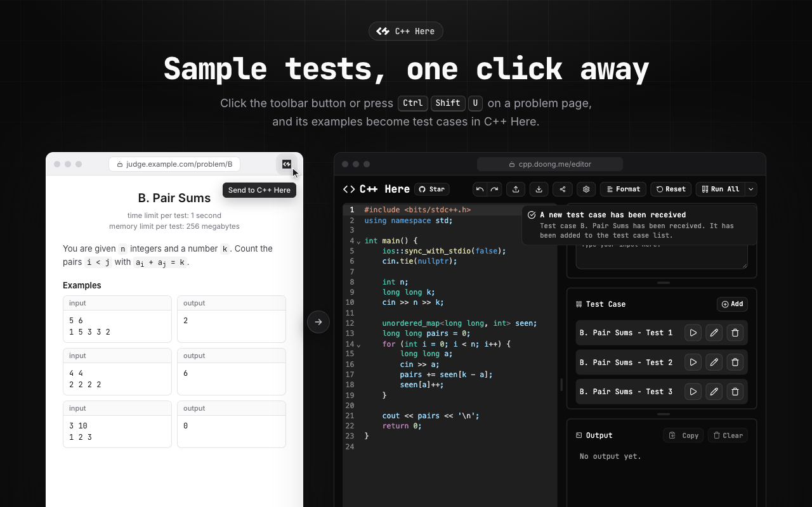
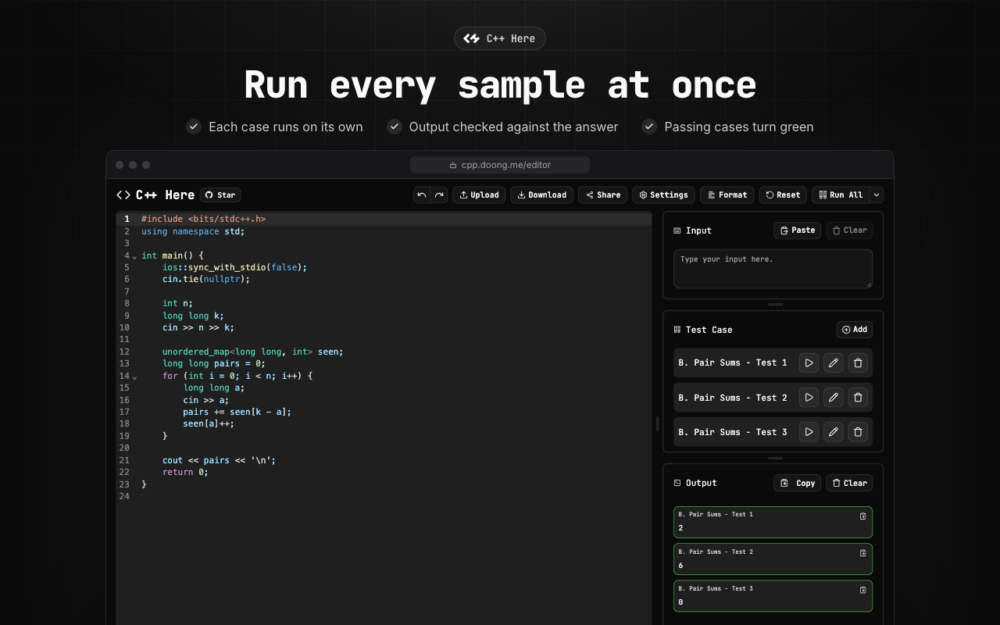
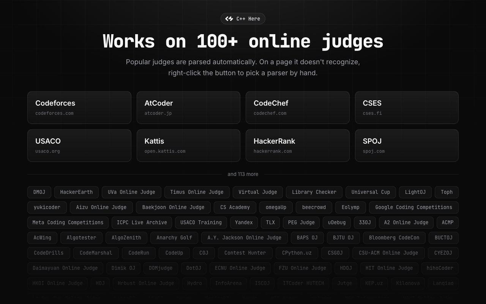

import { CHROME_WEB_STORE_URL, FIREFOX_ADDONS_URL } from "@/lib/extension";

export const SOURCE_URL =
    "https://github.com/Dong-Chen-1031/CPP-here/tree/main/extensions";

Every problem starts the same way: copy the first sample input, paste it, copy the expected output, paste it, and repeat for the next sample. With three or four samples that's six to eight round trips, and one missed line or trailing space is enough to send you chasing a bug that isn't there.

The C++ Here browser extension does all of that in one click.

## How it works

1. Open a problem on a supported judge.
2. Click the C++ Here button in your toolbar, or press <kbd>Ctrl</kbd>+<kbd>Shift</kbd>+<kbd>U</kbd> (<kbd>⌘</kbd>+<kbd>Shift</kbd>+<kbd>U</kbd> on Mac).
3. The C++ Here editor opens with every sample already added as a test case.

## Run every sample at once

Once the samples are in, press **Run All**. Each test case runs on its own, its output is compared with the expected answer, and the ones that pass turn green. You can see at a glance which sample fails, without scrolling through one long block of output.

Your code compiles and runs right in the browser, so there's no compiler to install and nothing to set up before a contest.

## 100+ judges

The extension recognizes problems on more than 100 websites, including Codeforces, AtCoder, CSES, Luogu, CodeChef, Kattis, DMOJ, USACO, and Virtual Judge. On a supported contest page, it imports every problem in the contest at once. The full list is in the [extension's README](https://github.com/Dong-Chen-1031/CPP-here/tree/main/extensions#supported-websites).

If you land on a page the extension doesn't recognize, right-click its toolbar button and pick a parser from the **Parse with** menu. If a site keeps needing that, add a custom rule on the options page so that URLs matching a pattern always use the parser you chose.

## It works with the tab you already have

If a C++ Here editor tab is already open, the extension sends the problem there instead of opening a new one. When that tab already has test cases, the editor asks before touching them: **Overwrite** replaces them with the new samples, and **Insert** adds the new samples after the ones you have.

## Privacy

The extension reads a page only when you ask it to, by clicking its button, pressing its shortcut, or choosing a parser from its menu. What it reads, the problem name and its samples, goes only to the C++ Here editor tab in your browser; the extension itself doesn't send it to any server. It has no ads and no tracking code, and it never reads your browsing history, form fields, passwords, or cookies.

The details, including which permissions it asks for and why, are in the [privacy policy](https://github.com/Dong-Chen-1031/CPP-here/blob/main/extensions/PRIVACY.md).

## Open source, thanks to Competitive Companion

The extension is open source under the MIT license, like the rest of C++ Here. Its problem parsers come from [Competitive Companion](https://github.com/jmerle/competitive-companion) by Jasper van Merle, which has been parsing problems for local tools for years. We kept those parsers and changed where problems go: instead of being sent to a program on your computer, they go straight to a C++ Here editor tab.

## Installing it

{/* The store links come from src/lib/extension.ts, like the landing page's install button. */}
{CHROME_WEB_STORE_URL || FIREFOX_ADDONS_URL ? (

<>
<ul>
{CHROME_WEB_STORE_URL && (
<li>
<strong>Chrome, Edge, and other Chromium browsers</strong>:
get it from the <a href={CHROME_WEB_STORE_URL} target="_blank" rel="noopener noreferrer">Chrome Web Store</a>.
</li>
)}
{FIREFOX_ADDONS_URL && (
<li>
<strong>Firefox</strong>: get it from{" "}
<a href={FIREFOX_ADDONS_URL} target="_blank" rel="noopener noreferrer">Firefox Add-ons</a>.
</li>
)}
</ul>

Once it's installed, the C++ Here button appears in your toolbar; if
you don't see it, pin it from your browser's extensions menu. The
source code is on <a href={SOURCE_URL} target="_blank" rel="noopener noreferrer">GitHub</a>.

</>
) : (

The extension works in Chrome, Edge, and Firefox. The source code, along
with build steps for loading it into your browser yourself, is on{" "}
<a href={SOURCE_URL} target="_blank" rel="noopener noreferrer">GitHub</a>.

)}

Found a problem page that doesn't parse correctly? Please [open an issue](https://github.com/Dong-Chen-1031/CPP-here/issues) with a link to the page.
