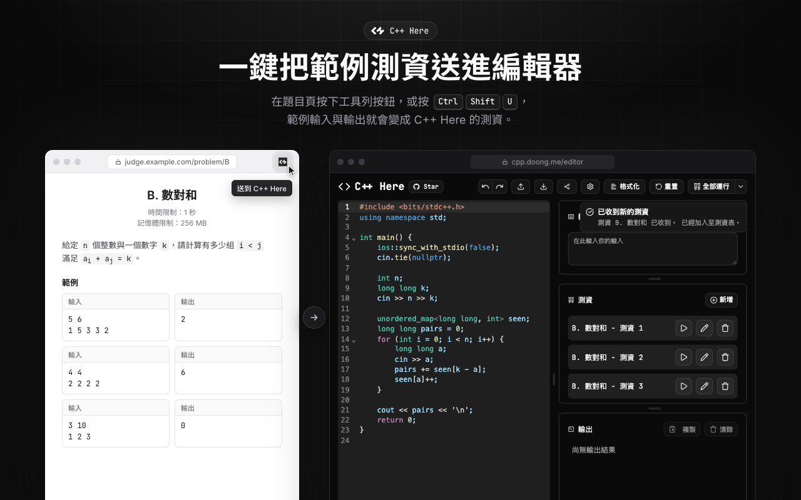
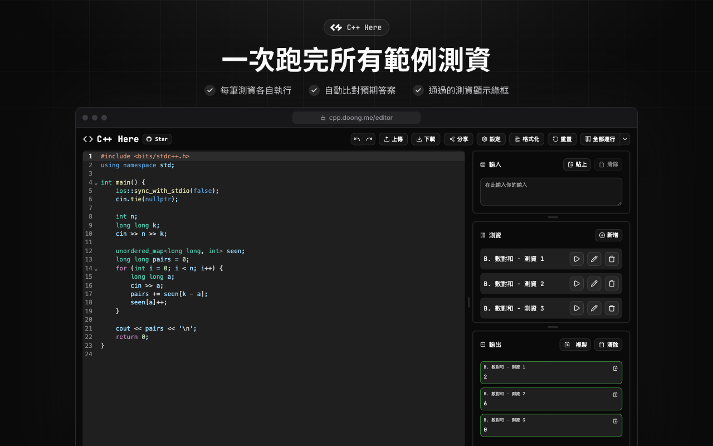
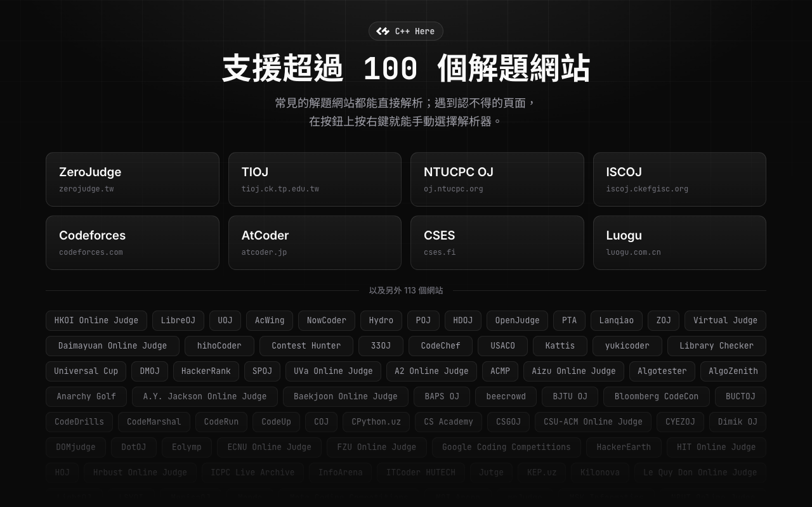

import { CHROME_WEB_STORE_URL, FIREFOX_ADDONS_URL } from "@/lib/extension";

export const SOURCE_URL =
    "https://github.com/Dong-Chen-1031/CPP-here/tree/main/extensions";

每次要寫一個題目時總是要這麼做：複製第一組範例輸入、貼上，複製預期輸出、貼上，再換下一組。一題有三、四組範例，就要來回六到八次；只要漏了一行或多了一個空白，就可能花上好一陣子找一個根本不存在的 bug。

C++ Here 瀏覽器擴充功能讓你一鍵搞定這些繁瑣的步驟。

## 怎麼用

1. 在支援的解題網站打開一道題目。
2. 按工具列上的 C++ Here 按鈕，或按 <kbd>Ctrl</kbd>+<kbd>Shift</kbd>+<kbd>U</kbd>（Mac 為 <kbd>⌘</kbd>+<kbd>Shift</kbd>+<kbd>U</kbd>）。
3. C++ Here 編輯器會打開，每組範例都已經是一筆測資。

## 一次跑完所有範例

範例匯入後，按「全部運行」。每筆測資會各自執行，輸出會自動和預期答案比對，通過的會變成綠框。哪一組沒過一眼就看得到，不用在一大段輸出裡慢慢找。

程式直接在瀏覽器裡編譯和執行，不用安裝編譯器，比賽前也不用設定任何東西。

## 超過 100 個解題網站

擴充功能認得超過 100 個網站的題目，包括 ZeroJudge、TIOJ、Codeforces、AtCoder、CSES、Luogu、CodeChef 和 Virtual Judge。在支援的比賽頁面上，還能一次匯入整場比賽的所有題目。完整清單在[擴充功能的 README](https://github.com/Dong-Chen-1031/CPP-here/tree/main/extensions#supported-websites)。

遇到擴充功能認不出的頁面，在工具列按鈕上按右鍵，從「使用解析器」選單手動選一個。如果某個網站常常需要這樣做，可以在選項頁加一條自訂規則，讓符合特定網址的頁面固定使用你選的解析器。

## 沿用你已經打開的分頁

如果已經有 C++ Here 編輯器的分頁開著，擴充功能會把題目送到那個分頁，不會另開新的。那個分頁裡已經有測資時，編輯器會先問你：「覆寫」會用新的範例取代原本的測資，「插入」則會把新的範例加在原本的測資後面。

## 隱私

只有在你按下按鈕、使用快捷鍵，或從選單選擇解析器時，擴充功能才會讀取當下的頁面。讀到的內容（題名和範例）只會送到你瀏覽器裡的 C++ Here 編輯器分頁，擴充功能本身不會把它傳到任何伺服器。它沒有廣告，也沒有追蹤程式碼，不會讀取你的瀏覽紀錄、表單、密碼或 Cookie。

完整的說明，包括它要求哪些權限、為什麼需要，都寫在[隱私權政策](https://github.com/Dong-Chen-1031/CPP-here/blob/main/extensions/PRIVACY.md)裡。

## 開放原始碼，感謝 Competitive Companion

擴充功能和 C++ Here 的其他部分一樣，以 MIT 授權開放原始碼。它的題目解析器來自 Jasper van Merle 的 [Competitive Companion](https://github.com/jmerle/competitive-companion)，這個專案多年來一直在幫各種本機工具解析題目。我們保留了這些解析器，只改了題目送去的地方：不是送到你電腦上的程式，而是直接送進 C++ Here 的編輯器分頁。

## 安裝

{CHROME_WEB_STORE_URL || FIREFOX_ADDONS_URL ? (

<>
<ul>
{CHROME_WEB_STORE_URL && (
<li>
<strong>Chrome、Edge 和其他 Chromium 瀏覽器</strong>：到{" "}
<a href={CHROME_WEB_STORE_URL} target="_blank" rel="noopener noreferrer">
Chrome 線上應用程式商店
</a>
按「加到 Chrome」。
</li>
)}
{FIREFOX_ADDONS_URL && (
<li>
<strong>Firefox</strong>：到{" "}
<a href={FIREFOX_ADDONS_URL} target="_blank" rel="noopener noreferrer">
Firefox 附加元件
</a>
按「新增至 Firefox」。
</li>
)}
</ul>

裝好後，工具列上會多一個 C++ Here 按鈕；如果沒看到，可以從瀏覽器的擴充功能選單把它釘選出來。原始碼放在{" "}
<a href={SOURCE_URL} target="_blank" rel="noopener noreferrer">
GitHub
</a>{" "}
上。

</>
) : (

擴充功能支援 Chrome、Edge 和 Firefox。原始碼，以及自己建置並載入瀏覽器的步驟，都在{" "}
<a href={SOURCE_URL} target="_blank" rel="noopener noreferrer">
GitHub
</a>{" "}
上。

)}

遇到解析錯誤的題目頁面嗎？歡迎到 GitHub [開 issue](https://github.com/Dong-Chen-1031/CPP-here/issues) 回報，並附上頁面連結。
